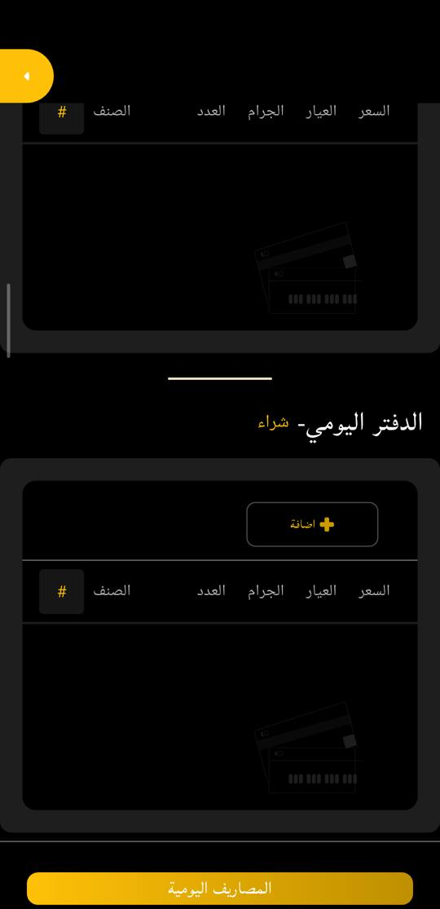
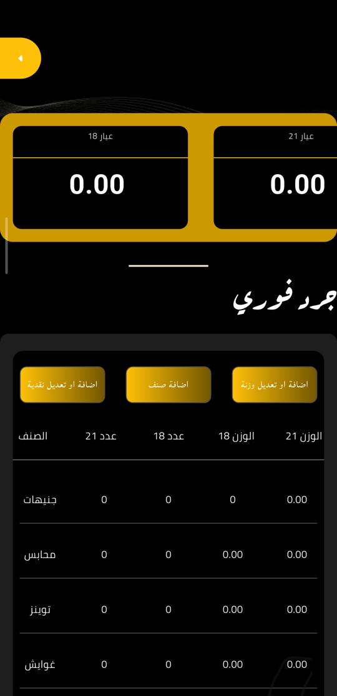
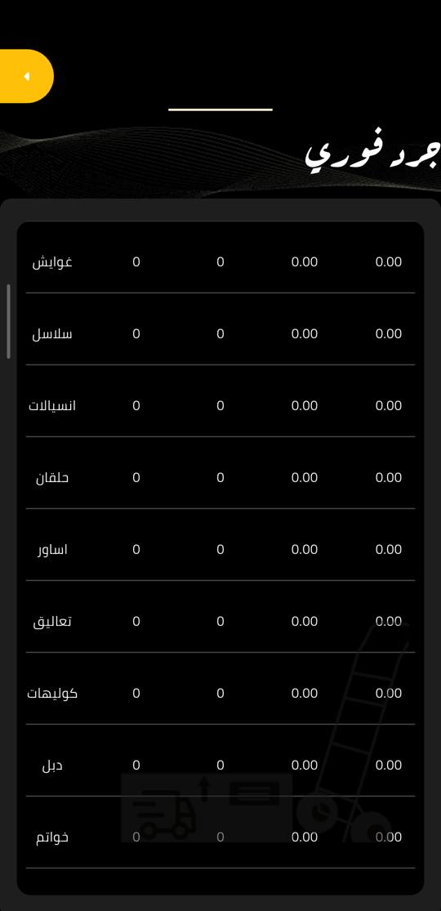
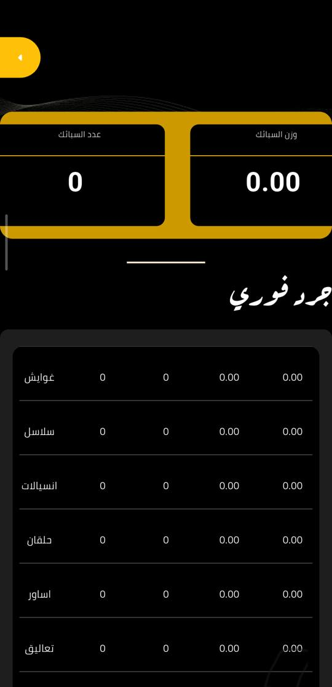
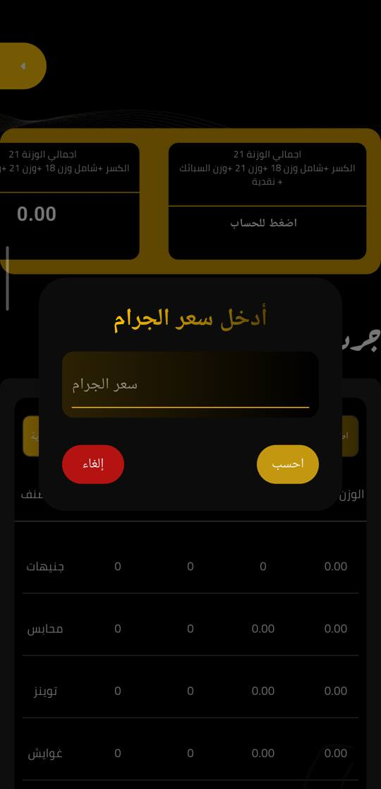
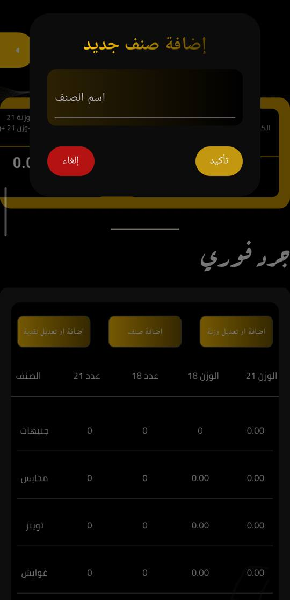
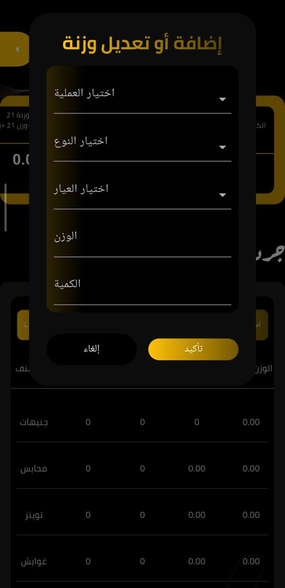
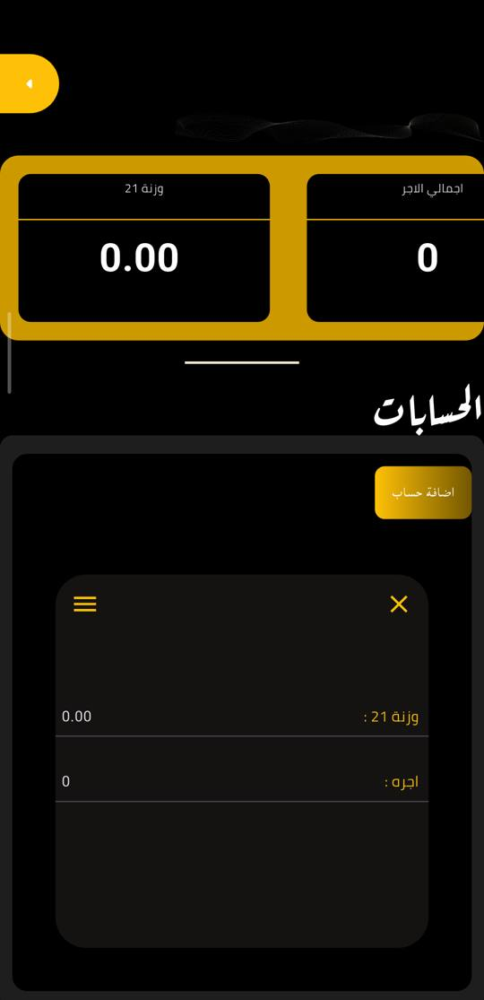

# Old app reference (captured 2026-11-10)

The owner asked that pages follow the old app's concept, in the new design. This records its layout and labels, read from the activated old app (`com.eldafttarerp.eldafttar` 1.0.0) on the user's phone over `adb`. The shop had no data, so every figure is zero. Nothing was saved or changed in the old app. The screenshots below have the phone's status bar cropped off and contain no customer data.

## Navigation

A side menu opened from a tab at the top start of every page: «برنامج الدفتر» (title), «الدفتر اليومي», «جرد فوري», «حسابات», «المرمات», «تحليلات», «الدفاتر», «النوتة», then «اضافة موظف», «تسجيل خروج», «هل تريد حذف الحساب ؟». There is no customers page and no invoice screen.

## «جرد فوري»

1. **Figure carousel** at the top, two boxes visible, swiped sideways, in this order:
   «عيار 18» (weight), «عيار 21» (weight), «عدد السبائك», «وزن السبائك», «اجمالي النقدية», «الكسر 18», «الكسر 21», «اجمالي الكسر 21» (18 and 21 scrap converted to 21), «اجمالي الوزنة 21» (18 + 21 + bullion, as 21), «اجمالي الوزنة 21» (scrap + 18 + 21 + bullion, as 21), and «اجمالي الوزنة 21 … + نقدية / اضغط للحساب», which asks «أدخل سعر الجرام» and converts cash into 21 weight («احسب» / «إلغاء»).
2. Title «جرد فوري», then three buttons: «اضافة او تعديل نقدية», «اضافة صنف», «اضافة او تعديل وزنة».
   - «اضافة صنف»: one name field, «تأكيد» / «إلغاء».
   - «إضافة أو تعديل وزنة»: «اختيار العملية» (إضافة / خصم), «اختيار النوع» (the item list below plus جنيهات، سبائك، كسر), «اختيار العيار» (18k, 21k, 24k).
3. **Table**: «الصنف», «عدد 21», «عدد 18», «الوزن 18», «الوزن 21». Counts are integers; weights have two decimals. Only 18 and 21 have columns.
   Rows, in order: جنيهات، محابس، توينز، غوايش، سلاسل، انسيالات، حلقان، اساور، تعاليق، كوليهات، دبل، خواتم. Every row shows with zeros even with no stock.

Item list in the weight form and the sale form, in that order: جنيهات، سبائك، كسر، حلقان، كوليهات، سلاسل، انسيالات، تعاليق، محابس، توينز، غوايش، خواتم، اساور، دبل.

## Other pages

- **«الدفتر اليومي»**: «لا يوجد تعاملات اليوم», then «الدفتر اليومي - بيع» and «الدفتر اليومي - شراء», each with «اضافة» and a table «#، الصنف، العدد، الجرام، العيار، السعر», then a «المصاريف اليومية» button. The sale form «اضافة منتج»: «نوع المنتج» (default خواتم), count (default 1), «ادخل الجرام», «ادخل السعر», «عيار» (18k default), «طريقة الدفع» (نقدي default), «اضافة» / «الغاء».
- **«الحسابات»** (traders): figures «وزنة 21» and «اجمالي الاجر», «اضافة حساب», and per account «وزنة 21» and «اجره».
- **«المرمات»**: «اضافة مرمة»; each card shows المنتج، متطلبات التصليح، تم دفعه، المتبقي من الحساب، اسم العميل، ملحوظة, a status «لم يتم التصليح», and the line «ملحوظة: العمليات التي تتم بالصفحة ليس لها علاقة بجرد المحل».
- **«تحليلات»**: four charts, each with «سنوي»: «المبيعات», «الشراء», «نسبة البيع و الشراء», «نسبة البيع من المنتجات».
- **«الدفاتر»**: «تحديد التاريخ» date picker, then that date's ledger.
- **«النوتة»**: two lists, «للمحل» and «على المحل», each with «اضافة حساب» and «الإجمالي: نقدية = … | وزن = … جرام» (money and gold owed to and by the shop).

## Differences from the new app (input to the next batch)

1. **Item rows and names.** The old table always shows its 12 rows with zeros, plural names, and جنيهات as a row. The new table shows only items with stock, singular built-ins (خاتم، حلق، سلسلة، تعليقة), and no coin row. Owner answers A4 and B4 ask for the old list with zeros.
2. **Figures.** The old carousel has 11 figures, including totals converted to 21 and the cash-to-21 calculator. The new page has six figures with no converted totals. The ledger home already has a normalization karat («جرام محيف عيار 21»), which the converted totals can reuse.
3. **Table columns.** Old: count columns, then weight columns. New: one column per karat with the count over the weight, plus «عيارات أخرى» for 22 and 14 and a karat order, which the owner asked for in FB-003. The owner accepted the new design as long as the concept stays.
4. **Weight and cash adjustments.** The old page has «اضافة او تعديل وزنة» and «اضافة او تعديل نقدية» on the inventory page. The new app keeps these as inventory addition, removal, and correction under «العمليات».
5. **Names.** Old «المرمات», «حسابات», «النوتة», «جرد فوري». New «الصيانة», «التجار والأمانات», «الديون», «الجرد الفوري». The owner asked for «مرمات» (B3); the others were not raised.
6. **Repairs.** The old page states repairs do not touch inventory and keeps «تم دفعه» / «المتبقي». The new one posts money to cash on collection, which the owner asked for in FB-009.

## Screenshots

| Screen | File |
|---|---|
| Side menu |  |
| «الدفتر اليومي», top |  |
| «الدفتر اليومي», purchases and «المصاريف اليومية» |  |
| Sale form «اضافة منتج» |  |
| «جرد فوري», figures, buttons, first rows |  |
| «جرد فوري», remaining rows |  |
| «جرد فوري», figures swiped to bullion |  |
| Cash to 21 weight: «أدخل سعر الجرام» |  |
| «إضافة صنف جديد» |  |
| «إضافة أو تعديل وزنة» |  |
| «الحسابات» (traders) |  |
| «المرمات» |  |
| «تحليلات» |  |
| «الدفاتر» |  |
| «النوتة» |  |

The full figure carousel order is in the «جرد فوري» section above; only the bullion position has a screenshot.
